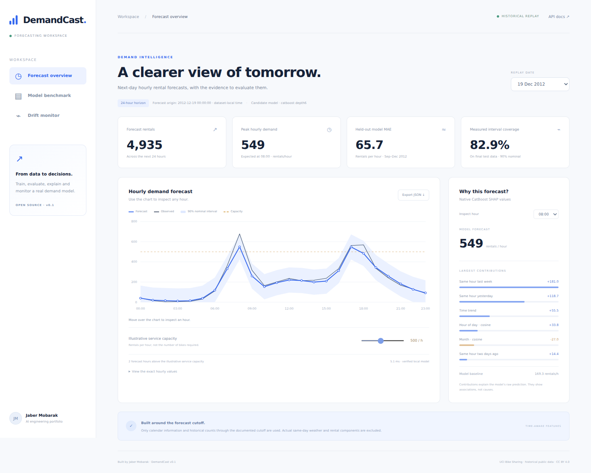
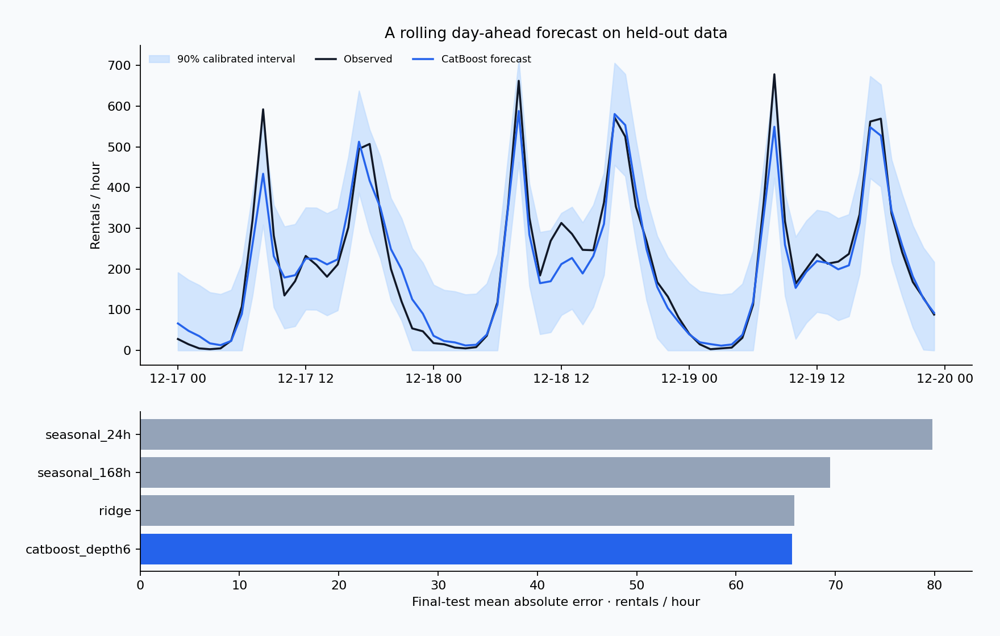

# DemandCast

### A clearer view of tomorrow.

A complete day-ahead demand forecasting project: **SQL features → model training → chronological evaluation → MLflow registry → prediction API → explanations and monitoring**.

Built by **Jaber Mobarak** as an AI / ML engineering portfolio project. The included model was trained on real public observations; it is not a pretrained language-model wrapper.



## Run the dashboard

Python 3.11 or 3.12 is recommended. The repository includes a small trained CatBoost model and a historical replay sample, so you can run the app without retraining, downloading model weights, using a GPU, or supplying an API key.

```bash
python -m venv .venv
# Windows PowerShell:
.venv\Scripts\Activate.ps1
# macOS / Linux instead:
# source .venv/bin/activate
python -m pip install -e .
python -m demandcast.cli serve --open
```

Open **http://127.0.0.1:8010**. API documentation: **http://127.0.0.1:8010/docs**.

On Windows, `start_windows.bat` also installs the package and opens the dashboard. Start it from an activated environment if you want dependencies isolated.

Choose a historical date, inspect an hour's forecast explanation, compare the final-test baselines, and run a clearly labeled synthetic drift stress test. The service-capacity slider is an illustrative rental-throughput threshold; it does not estimate the number of physical bikes required.

## The problem

How many rentals should an operator expect during each hour of the next day, and how should an engineer decide whether to trust that forecast?

This project addresses the engineering workflow around that question. It does not claim to operate a real bike-sharing service. The data is the public **UCI Bike Sharing dataset, 2011–2012**, attributed in [DATA_LICENSE.md](DATA_LICENSE.md). Observed rentals are not the same as unconstrained demand, stock requirements, or business profit.

## What this adds to the portfolio

| Skill | Inspectable implementation |
| --- | --- |
| Data engineering / SQL | DuckDB window queries, clock-hour alignment, missing-hour preservation, explicit feature contract |
| Model training | Three CatBoost candidates, Ridge, and two seasonal-naive baselines |
| Validation | Separate chronological train, selection, calibration and final-test periods |
| Statistics | MAE/RMSE/WAPE, residual-calibrated intervals, paired seven-day-block uncertainty diagnostic |
| MLOps | Real local MLflow experiments, model registration, candidate alias and reload verification |
| Explainability | Native CatBoost SHAP contributions, with additivity checked against the model output |
| Serving | FastAPI/Pydantic batch inference, model-bundle checksums, shared training/inference feature logic |
| Monitoring | Feature PSI, missingness, explicit small-sample warning, synthetic input-shift control, Prometheus metrics |
| Software delivery | Behavior tests, Docker/Compose, GitHub Actions, responsive browser UI and a self-contained Colab notebook |

There is no Kubernetes cluster, Spark pipeline, cloud deployment, live customer traffic, or automatic retraining service in this version. The purpose is to demonstrate a working, measured small system rather than claim enterprise scale.

## Forecast protocol and leakage boundary

At **00:00 at the start of a day**, predict that day's 24 hourly rental intervals. Dataset timestamps are timezone-naive. A count labeled 23:00 covers the preceding day's 23:00 hour and is assumed available at the following 00:00 boundary. Additional ingestion delay is not modeled.

The latest demand-derived input for a target hour `t` is the completed hour labeled `t − 24h`; it becomes available at `t − 23h`, which is always at or before the day-start origin. We deliberately omit more recent history even when it would be available for earlier forecast horizons. This conservative simplification is documented rather than hidden.

The model uses three lags, two shifted rolling means, and deterministic calendar/time features. It excludes actual same-day weather and the `casual` / `registered` columns, which directly sum to the rental target. Missing clock hours are added to the grid with unknown targets, not fabricated zero rentals. See [the SQL](src/demandcast/sql/features.sql) and [design decisions](docs/DESIGN.md).

During final-test replay, actual observations from previous test days become available for later daily origins. This is a rolling day-ahead evaluation, not a single four-month forecast made in September.

## Measured results

The pinned archive contains **17,379 observed hours** on a grid of **17,544 hours**. There are **165 missing clock hours**. After history warmup, the final September–December 2012 test contains **2,888 observed target hours**.

| Model | Test MAE, rentals/hour | Test RMSE | WAPE |
| --- | ---: | ---: | ---: |
| Selected CatBoost | 65.67 | 100.16 | 27.34% |
| Ridge | 65.90 | 100.70 | 27.43% |
| Same hour last week | 69.50 | 117.78 | 28.93% |
| Same hour yesterday | 79.77 | 133.15 | 33.21% |

The CatBoost point estimate has **5.51% lower MAE than the weekly baseline**. Its margin over Ridge is small. The descriptive paired moving-block bootstrap intervals include zero, so these results do not establish decisive superiority or statistical significance.

The nominal 90% intervals achieve **82.86% empirical test coverage**, showing undercoverage. We keep that limitation visible in the app. The calibration method's exchangeability assumption is not guaranteed for this time series.



Read [the full benchmark](reports/benchmark.md), [machine-readable results](reports/benchmark.json), and [every held-out prediction](reports/holdout_predictions.csv). Candidate selection used July validation data; August set the interval radius. Final-test results were not used to choose model parameters or thresholds.

## Train it yourself

```bash
python -m pip install -e '.[train,dev]'
python -m demandcast.cli train
python -m pytest -q
python -m ruff check .
```

Training downloads the small official UCI archive, checks its pinned SHA-256, builds features using SQL, fits the candidates, chooses the CatBoost candidate by validation MAE, calibrates intervals, evaluates the holdout, and rebuilds the bundle/reports. Training needs network access for the dataset; subsequent runs reuse the verified archive. Fit parameters and seed are fixed in source. Serialized model bytes can differ because of model metadata even when predictions match.

The command creates a local SQLite MLflow tracking database under `data/mlflow/`, records six comparison runs per invocation, registers the selected CatBoost model, and assigns the `candidate` alias. It does not promote a production model. `reports/experiment_runs.json` and `reports/mlflow-check.json` are readable release records; the local tracking database is not committed.

After training, inspect your own MLflow runs:

```bash
python -m mlflow ui --backend-store-uri sqlite:///data/mlflow/tracking.db --port 5000
```

Open http://127.0.0.1:5000. `--no-tracking` skips MLflow when running the training command; the `train` extra still supplies plotting dependencies.

## API example

```bash
curl 'http://127.0.0.1:8010/api/forecast?date=2012-12-19'
curl 'http://127.0.0.1:8010/api/explain?timestamp=2012-12-19T08:00:00'
```

`GET /api/forecast` is explicitly a historical replay endpoint for bundled dates. `POST /api/predict` performs model inference for supplied past-count features; it does not invent unavailable history.

```json
{
  "rows": [{
    "timestamp": "2013-01-01T08:00:00",
    "lag_24": 100,
    "lag_48": 120,
    "lag_168": 140,
    "rolling_mean_24": 110,
    "rolling_mean_168": 130
  }]
}
```

For each row, the caller must respect the documented historical cutoff and calculate rolling means over the correct clock-hour windows. The server derives calendar features, rejects unexpected/leaky fields, negative counts, non-finite values, timezone-aware or subhour timestamps, all-missing history, and batches larger than 168 rows. It warns that dates outside the historical evaluation period have unvalidated quality. JSON `null` is allowed for an individual missing historical feature.

Other routes: `GET /api/config`, `GET /api/benchmark`, `GET /api/monitor`, `POST /api/monitor/simulate`, `GET /health`, `GET /metrics`.

Set `DC_API_TOKEN` to require a bearer token on `/api/*` and `/metrics`. The default server binds to localhost. Environment variables are read at startup; `.env.example` is a reference and is not automatically loaded by Python. The app does not persist prediction payloads. The browser token remains in page memory only.

## Monitoring and interpretation

PSI compares the most recent bundled historical week with August's reference distribution, including a missing-value bin. A threshold of 0.20 is a review heuristic, not a significance test. Seasonal or holiday-related distribution shifts can be ordinary rather than a broken model. The UI distinguishes the historical snapshot from the synthetic feature-multiplier stress test. Neither triggers retraining or model promotion.

Prometheus counters and latency histograms at `/metrics` describe requests handled by this process. They are in-memory counters, not a hosted observability platform or evidence of production traffic.

SHAP contributions add up to the raw CatBoost output; displayed demand is clipped at zero. Explanations describe model associations, not causes. Intervals are per-hour, not a calibrated interval for the daily sum.

## Docker and Colab

```bash
docker compose up --build
```

The image runs the bundled historical demo as a non-root user and binds to localhost through Compose. See [validation status](docs/VALIDATION.md) for what was actually executed.

Open `notebooks/DemandCast_Complete_Portfolio.ipynb` in Google Colab and choose **Runtime → Run all**. It includes the source and model bundle, can retrain the full pipeline on CPU, runs the tests, and displays the app through Colab's authenticated port proxy. No paid API key or GPU is required. Paste the printed temporary workspace token into the app, and clear notebook outputs before sharing a copy. Colab runtimes are temporary; use the notebook's export cell before disconnecting if you want to keep retrained outputs.

## Repository map

- `src/demandcast/`: data acquisition, SQL features, training, evaluation, monitoring, serving and browser interface.
- `artifacts/`: trained model, calibration/reference data, attributed historical replay sample and checksums.
- `reports/`: executed results, candidate runs, prediction-level outputs, plots and validation records.
- `tests/`: leakage, missing-hour, feature-contract, model/API, SHAP and monitoring checks.
- `docs/`: [design](docs/DESIGN.md), [hiring research](docs/HIRING_RESEARCH.md), [validation](docs/VALIDATION.md), and [interview guide](docs/INTERVIEW_GUIDE.md).
- `tools/`: self-contained notebook builder.

## Authorship and limits

The project was developed with AI assistance. Reproduce the workflow, inspect its failure cases, and understand the feature cutoff and metrics before discussing it in an interview. This is project experience; it is not commercial employment, an original forecasting algorithm, or proof that the model is suitable for a live business.

Code is MIT-licensed. Public source-data attribution is preserved in [DATA_LICENSE.md](DATA_LICENSE.md).
